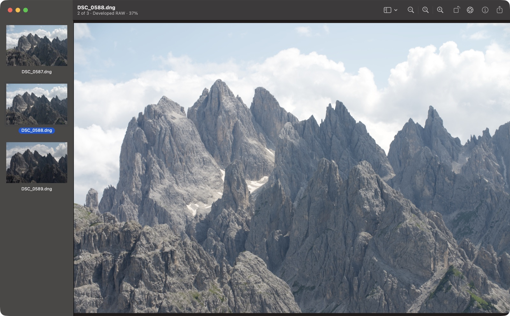

# RawViewer

A fast camera RAW viewer for macOS, for looking through and culling a photo import.
It has the familiar Preview-style window: thumbnails on the left, the image in the middle, EXIF info on the right.



## Features

- **Instant RAW display.** Shows the JPEG your camera embedded in every RAW file, decoded at full size in about 60 ms for a 24 MP Nikon NEF.
- **Real RAW develop when it matters.** Zoom past the embedded JPEG, or turn on Develop RAW, and the RAW data is developed on the GPU with Core Image.
- **Quick culling.** Press ⌫ to move the image to the Trash, or select several thumbnails and delete them together. A confirmation always comes first. Matching `.xmp` sidecars go with their image.
- **Info panel.** Camera, lens, exposure and every EXIF field of the current image.
- **Any image format macOS can read.** NEF, CR3, ARW, RAF, DNG and other RAW formats, plus JPEG, HEIC, PNG and TIFF.

## Install

**Download:** get `RawViewer-<version>.zip` from [Releases](../../releases), unzip it, and drag RawViewer to Applications. Releases are signed and notarized.

**Build from source:** you need the Xcode Command Line Tools (`xcode-select --install`). Full Xcode is not required.

```sh
git clone https://github.com/vbolshakov87/RawViewer.git
cd RawViewer
make install      # builds and copies RawViewer.app into /Applications
```

`make app` only builds `build/RawViewer.app` without installing it.

To open RAW files in RawViewer by default, select a RAW file in Finder and choose File > Get Info. Under Open With, pick RawViewer, then click Change All.

**Requirements:** macOS 14 or later on Apple silicon. Development and testing happen on macOS 27.

## Using it

Open files or a whole folder with ⌘O, by dropping them on the window or Dock icon, or with Finder's Open With.

| Action | Keys |
|---|---|
| Next or previous image | → / ← , ↓ / ↑ , Space, or ⌥⌘↓ / ⌥⌘↑ |
| Zoom to fit, actual size | ⌘9, ⌘0 |
| Zoom in, out | ⌘+, ⌘− or pinch |
| Rotate left, right (display only) | ⌘L, ⌘R |
| Show or hide Info panel, sidebar | ⌘I, ⌥⌘S |
| Develop RAW for every image | ⇧⌘R |
| Select several | ⇧-click, ⌘-click, ⇧↑ / ⇧↓, ⌘A |
| Move to Trash (asks first) | ⌫ or ⌘⌫ |
| Delete immediately, skipping the Trash (asks first) | ⌥⌘⌫ |
| Show in Finder, copy image | ⌥⇧⌘R, ⌘C |
| Full screen | ⌃⌘F |

The window subtitle shows the position, the selection count, whether you see the camera JPEG or a developed RAW, and the zoom level.

## Why it is fast

1. **Embedded camera JPEG first.** Every RAW file carries a JPEG the camera rendered. It is decoded at its native size, which is quicker than shrinking it, and nothing is demosaiced.
2. **RAW develop only when needed.** Core Image's `CIRAWFilter` develops on the GPU at just the scale the zoom requires.
3. **Neighbours are prefetched.** The next two images and the previous one are decoded ahead, so arrow-key browsing is instant.
4. **The GPU draws.** The image is a layer's contents, so zooming and panning never redraw on the CPU.

Timings on an Apple silicon Mac, from `RawViewer --bench <file>` (second pass):

| File | Sidebar thumbnail | First paint | Full RAW develop |
|---|---|---|---|
| Nikon Z6III NEF, 24 MP | 16 ms | 62 ms at 6048 px | 190 ms |
| Nikon NEF, 10 MP | 14 ms | 31 ms at 3984 px | 113 ms |
| DNG with a 1024 px preview, 24 MP | 28 ms | 86 ms, then a 135–290 ms develop | 57–290 ms |

## Development

```sh
make app                                  # build/RawViewer.app
.build/release/RawViewer --bench a.NEF    # time each decode stage
make icon                                 # redraw Resources/AppIcon.icns
```

Setting `RAWVIEWER_SELFTEST=<dir>` runs a scripted UI session, for example `RAWVIEWER_ACTIONS=next,zoomin,shiftnext,trash,cancel`. It logs decode timings to stderr. After each step it saves `stepN.png` from AppKit drawing and `stepN-real.png` as the window server composites it. The full action list is in `SelfTest.swift`. Run deletion actions only on copies of your photos.

## Releasing

Releases are built on the maintainer's Mac, so no signing secrets live in GitHub.

One-time setup:

1. In your Apple Developer account, create a **Developer ID Application** certificate from a certificate signing request made in Keychain Access, then double-click the downloaded `.cer`. `security find-identity -v -p codesigning` should list it.
2. Create an app-specific password at appleid.apple.com.
3. Store the notarization credentials in your keychain:

   ```sh
   xcrun notarytool store-credentials RawViewerNotary \
     --apple-id <your Apple ID> --team-id <TEAMID> --password <app-specific password>
   ```

For each release, bump `CFBundleShortVersionString` and `CFBundleVersion` in `Resources/Info.plist`, then:

```sh
make release                    # sign, notarize, staple → dist/RawViewer-<version>.zip
git tag v1.0.0 && git push --tags
gh release create v1.0.0 dist/RawViewer-1.0.0.zip --title "RawViewer 1.0.0" --notes "…"
```

## License

MIT. See [LICENSE](LICENSE).

RawViewer is an independent project and is not affiliated with Apple. Its layout is inspired by the Preview app that ships with macOS.
